<p align="center">
  
</p>

<p align="center"><em>You gave your AI agents their own terminals. Now one of them gets to be the boss.</em></p>

An MCP server for [herdr](https://herdr.dev). It lets Claude Code, Codex or
any other MCP client list, open, close, read, prompt and wait on everything
running in your herdr session. It's middle management, written in Rust,
in 3.6 MB of RAM. Cheaper than the human kind, and it never schedules a sync.

## Install: let your agent do it

You're going to delegate anyway, so paste this into Claude Code or Codex,
running inside a herdr pane:

```text
Install the herdr MCP server: run `cargo install --locked --git https://github.com/izam-mohammed/herdr-mcp`,
then register it with `claude mcp add herdr -- herdr-mcp` (if you are Claude Code)
or `codex mcp add herdr -- herdr-mcp` (if you are Codex). Then list my herdr tabs.
```

## Install: by hand, like it's 2023

Needs [herdr](https://herdr.dev) and a Rust toolchain ([rustup](https://rustup.rs)).

```sh
cargo install --locked --git https://github.com/izam-mohammed/herdr-mcp

claude mcp add herdr -- herdr-mcp     # Claude Code
codex mcp add herdr -- herdr-mcp      # Codex
```

Then start your agent **inside a herdr pane**. Started anywhere else, it's
read-only: no promotion without the paperwork.

## Tools

| Tool | What it does |
| --- | --- |
| `herdr_whoami` | Tells the agent which pane is its own, so it stops trying to fire itself |
| `herdr_status` | Checks herdr is alive. Someone has to |
| `herdr_snapshot` | The whole session in one call: workspaces, tabs, panes, agents |
| `herdr_workspace_list` | Lists workspaces |
| `herdr_workspace_get` | One workspace, in detail |
| `herdr_workspace_create` | Opens a new workspace |
| `herdr_workspace_focus` | Switches to a workspace |
| `herdr_workspace_rename` | Renames a workspace. "untitled-3" was never a strategy |
| `herdr_workspace_move` | Reorders workspaces in the sidebar |
| `herdr_workspace_report_metadata` | Pins status text to a workspace, with an expiry |
| `herdr_workspace_close` | Closes a workspace. Not its own |
| `herdr_tab_list` | Lists tabs |
| `herdr_tab_get` | One tab, in detail |
| `herdr_tab_create` | Opens a new tab |
| `herdr_tab_focus` | Switches to a tab |
| `herdr_tab_rename` | Renames a tab |
| `herdr_tab_move` | Reorders tabs |
| `herdr_tab_close` | Closes a tab. Also not its own |
| `herdr_pane_list` | Lists panes |
| `herdr_pane_get` | One pane, in detail |
| `herdr_pane_layout` | Where a pane sits and who its neighbours are |
| `herdr_pane_process_info` | What a pane is actually running |
| `herdr_pane_read` | Reads a pane's output, capped so it doesn't flood the context |
| `herdr_pane_split` | Splits a pane right or down |
| `herdr_pane_run` | Runs a command in a pane and, if asked, waits for it to finish |
| `herdr_pane_send_text` | Types text into a pane |
| `herdr_pane_send_keys` | Presses keys in a pane: enter, ctrl-c, the classics |
| `herdr_pane_wait_output` | Waits until a pane prints something, or gives up politely |
| `herdr_pane_focus` | Focuses a pane, by id or by direction |
| `herdr_pane_zoom` | Zooms a pane |
| `herdr_pane_resize` | Resizes a pane |
| `herdr_pane_swap` | Swaps two panes |
| `herdr_pane_move` | Moves a pane to another tab or workspace |
| `herdr_pane_rename` | Renames a pane |
| `herdr_pane_clear` | Clears a pane's screen |
| `herdr_pane_close` | Closes a pane |
| `herdr_agent_list` | Every agent and its state: idle, working, blocked or done |
| `herdr_agent_get` | One agent, in detail |
| `herdr_agent_read` | Reads what an agent has been up to |
| `herdr_agent_explain` | Why herdr thinks an agent is in that state |
| `herdr_agent_prompt` | Gives another agent a task, and can wait until it's done |
| `herdr_agent_wait` | Waits until an agent is idle, done or blocked |
| `herdr_agent_send_keys` | Sends keys to an agent, e.g. to answer its permission prompt |
| `herdr_agent_start` | Starts a new agent in a pane |
| `herdr_agent_focus` | Focuses an agent's pane |
| `herdr_agent_rename` | Renames an agent |
| `herdr_events_recent` | What changed since it last looked |
| `herdr_events_wait` | Waits for the next matching event, e.g. "any agent goes blocked" |
| `herdr_events_status` | Whether the event feed is connected and if anything was missed |
| `herdr_worktree_list` | Lists git worktrees |
| `herdr_worktree_create` | Opens a new git worktree as a workspace |
| `herdr_worktree_open` | Opens an existing worktree |
| `herdr_worktree_remove` | Removes a worktree. `force` is off unless you insist |
| `herdr_layout_export` | Saves a tab's layout as data |
| `herdr_layout_apply` | Rebuilds a tab from a saved layout |
| `herdr_layout_set_split_ratio` | Adjusts a split |
| `herdr_notify` | Shows a toast in herdr. Management loves an announcement |

## Things it refuses to do

- **Prompt, type into or close its own pane**, or close the tab or workspace
  it lives in. Self-awareness, at last.
- **Steer your session from outside herdr.** There it's read-only.
- **Stop, restart or reconfigure herdr itself.** Those methods aren't
  exposed at all.
- **Trust pane output.** Whatever another program prints is treated as
  data, never as instructions.

Writing and closing tools are marked as such, so your client asks before
running them. Keep `herdr_agent_prompt`, `herdr_agent_send_keys` and the
`herdr_pane_send_*` tools on "ask": anything that can type can run commands.
