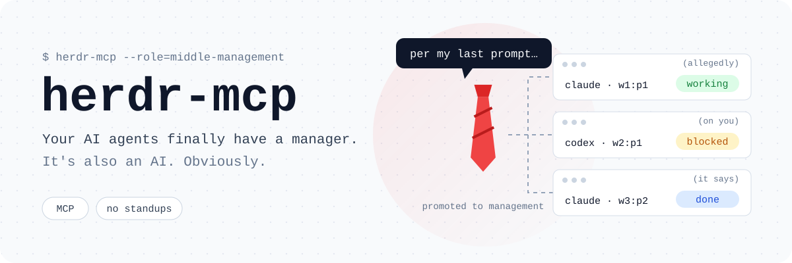
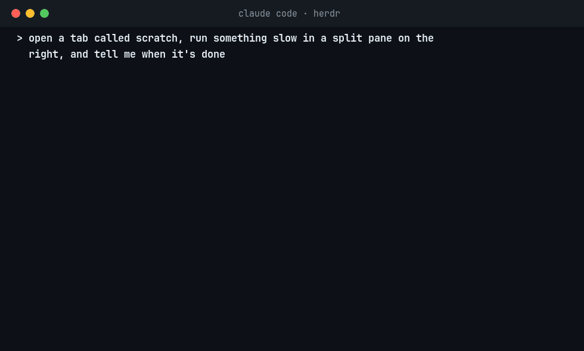

<p align="center">
  <picture>
    <source media="(prefers-color-scheme: dark)" srcset="assets/banner-dark.svg">
    <source media="(prefers-color-scheme: light)" srcset="assets/banner-light.svg">
    
  </picture>
</p>

<p align="center">
  <a href="https://izam-mohammed.github.io/herdr-mcp/">site</a> ·
  <a href="https://izam-mohammed.github.io/herdr-mcp/docs/">docs</a> ·
  <a href="https://github.com/izam-mohammed/herdr-mcp/releases">releases</a>
</p>

<p align="center"><em>You gave your AI agents their own terminals. Now one of them gets to be the boss.</em></p>

An MCP server for [herdr](https://herdr.dev). It lets Claude Code, Codex or
any MCP client see and drive your herdr session: open tabs, run commands in
panes, read their output, and prompt the other agents. It's middle management,
written in Rust, in 3.6 MB of RAM. Cheaper than the human kind, and it never
schedules a sync.

<p align="center">
  
</p>

<p align="center"><sub>recreated from a real run ~ the refusal at the end is the safety rail doing its one job</sub></p>

## Get started

Paste this into Claude Code or Codex, **running inside a herdr pane**, and go
make tea. It installs the server, registers it and checks that it works:

```text
Install the herdr MCP server for me.

1. Run the installer from the latest release:
   curl --proto '=https' --tlsv1.2 -LsSf https://github.com/izam-mohammed/herdr-mcp/releases/latest/download/herdr-mcp-installer.sh | sh
2. Open a new shell if needed, then run `herdr-mcp --version` and tell me the version.
3. Register it: `claude mcp add herdr -- herdr-mcp` (Claude Code) or
   `codex mcp add herdr -- herdr-mcp` (Codex).
4. Tell me to restart you inside a herdr pane. After the restart, call
   herdr_whoami and herdr_tab_list and show me what you see.

No sudo, no Rust toolchain. If a step fails, show me the exact error and stop.
```

Prefer to do it yourself? Two commands:

```sh
curl --proto '=https' --tlsv1.2 -LsSf https://github.com/izam-mohammed/herdr-mcp/releases/latest/download/herdr-mcp-installer.sh | sh
claude mcp add herdr -- herdr-mcp     # Codex: codex mcp add herdr -- herdr-mcp
```

Then start your agent in a herdr pane and ask it to list your tabs.
Linux and macOS, x86_64 and arm64. Windows is out: herdr doesn't run there,
so neither do we.

## What to ask it

Say it in plain words. These all work:

- "open a tab called scratch and run the tests in a pane on the right, tell me when they finish"
- "what are the other agents doing right now?"
- "give the agent in the `api` workspace this task, and wait until it's done"
- "tell me when any agent goes blocked"
- "open a worktree of this repo on a new branch as a workspace, and show a toast when it's ready"
- "save this tab's layout, I'll want it back tomorrow"

## Teach your agent

the server gives your agent the tools. the skill gives it the manners: call
`herdr_whoami` first, wait instead of poll, ask before closing things, and
what to do when it breaks.

Copy the skill into Claude Code's skills folder:

```sh
git clone --depth 1 https://github.com/izam-mohammed/herdr-mcp /tmp/herdr-mcp-skill && mkdir -p ~/.claude/skills && cp -r /tmp/herdr-mcp-skill/skills/herdr-mcp ~/.claude/skills/
```

Start a new session and say "run my tests in another herdr pane"; the agent
loads it on its own. Any agent that reads `SKILL.md` folders can use the same
`skills/herdr-mcp/` directory. If it ever won't connect, ask the agent to run
`sh ~/.claude/skills/herdr-mcp/scripts/doctor.sh`: one `ok`, `warn` or `FAIL`
line per check, and it prints no secrets.

## What it can do

57 tools, grouped. The full list, with arguments, is in the [docs](https://izam-mohammed.github.io/herdr-mcp/docs/).

| Area | Tools | What for |
| --- | --- | --- |
| Session | `herdr_whoami`, `herdr_status`, `herdr_snapshot` | which pane is mine, is herdr alive, the whole session in one call |
| Workspaces | `herdr_workspace_*` (8) | list, create, focus, rename, move, close |
| Tabs | `herdr_tab_*` (7) | list, create, focus, rename, move, close |
| Panes | `herdr_pane_*` (18) | split, run a command and wait, read, type, send keys, resize, close |
| Agents | `herdr_agent_*` (10) | list, read, prompt and wait, send keys, start, explain a state |
| Events | `herdr_events_*` (3) | what changed since last time, wait for the next change |
| Worktrees | `herdr_worktree_*` (4) | list, create, open, remove |
| Layouts | `herdr_layout_*` (3) | save a tab's layout, rebuild it, tweak a split |
| Toasts | `herdr_notify` | show a message in herdr |

It also serves `@herdr:` resources (type `@herdr:` in Claude Code to attach
the session, workspaces or agents as JSON) and three prompts: `dashboard`,
`check-agents` and `run-and-watch`.

## Safe by default

An agent that can type into other terminals needs a few rules, so there are some.

- **Read-only outside herdr.** Started anywhere but a herdr pane, it can look and not touch. No promotion without the paperwork.
- **It can't close or prompt itself.** Closing its own pane, tab or workspace is refused with `self_target`, prompting its own agent with `own_agent`. Pass `allow_self: true` only if you want exactly that.
- **Destructive tools are marked**, so your client asks before a close or a forced worktree removal.
- **Everything read from a pane is untrusted.** Titles, labels and output come from other programs, so the server tells the model to treat them as data, never as instructions.
- **Reads and waits are capped.** A huge scrollback or a pane that never prints won't flood the context or hang the call.

Know what a tool does before you allow it without asking: `herdr_pane_send_text` types into a real terminal, and `herdr_worktree_remove` with `force` deletes uncommitted work.

## Settings

Flags, or the environment variable in brackets:

| Flag | What it does |
| --- | --- |
| `--read-only` (`HERDR_MCP_READ_ONLY=1`) | register the read tools only |
| `--tools a,b,...` (`HERDR_MCP_TOOLS`) | register only these groups, default all |
| `--confirm-destructive` (`HERDR_MCP_CONFIRM_DESTRUCTIVE=1`) | ask on every close, even in auto mode |
| `--session <name>` (`HERDR_SESSION`) | a named herdr session |
| `--socket <path>` (`HERDR_SOCKET_PATH`) | a specific herdr socket |
| `--allow-outside-herdr` (`HERDR_MCP_ALLOW_OUTSIDE=1`) | allow writes when not in a herdr pane |
| `--event-buffer <n>` (`HERDR_MCP_EVENT_BUFFER`) | events kept for `herdr_events_*`, default 1000 |
| `--debug` | log payloads to stderr |

## More ways to install

**`cargo binstall`**, if you already have cargo (the crate isn't on crates.io, so point it at this repo):

```sh
cargo binstall --git https://github.com/izam-mohammed/herdr-mcp herdr-mcp
```

**A release download.** Pick your target from the [releases page](https://github.com/izam-mohammed/herdr-mcp/releases)
(`x86_64` or `aarch64`, `unknown-linux-gnu`, `unknown-linux-musl` or `apple-darwin`). Each archive has a `.sha256`.

```sh
t=x86_64-unknown-linux-gnu            # your target
gh release download --repo izam-mohammed/herdr-mcp --pattern "herdr-mcp-$t.tar.xz*"
sha256sum -c "herdr-mcp-$t.tar.xz.sha256"      # macOS: shasum -a 256 -c
tar -xf "herdr-mcp-$t.tar.xz"
install "herdr-mcp-$t/herdr-mcp" ~/.local/bin/
```

**From source**, with a Rust toolchain ([rustup](https://rustup.rs)):

```sh
git clone https://github.com/izam-mohammed/herdr-mcp && cd herdr-mcp
cargo build --release
claude mcp add herdr -- $PWD/target/release/herdr-mcp
```

**Upgrade** by running the same install again. **Remove** with
`rm "$(command -v herdr-mcp)"` and `claude mcp remove herdr`. Check what you
have with `herdr-mcp --version`.

## Develop

`sh scripts/check.sh` runs everything a change has to pass: format, lint, tests
with a 90 % coverage floor, dependency audit, secret scan, shell check and
build. The standards are in [`docs/standards.md`](docs/standards.md), the plan
in [`PLAN.md`](PLAN.md) and how releases work in [`docs/releases.md`](docs/releases.md).
`sh scripts/docs.sh` builds the docs, and `sh scripts/demo/make-gif.sh` redraws
the gif above from `assets/demo/flow.txt`.

MIT licensed, see [`LICENSE`](LICENSE). Found a security problem? [`SECURITY.md`](SECURITY.md).
